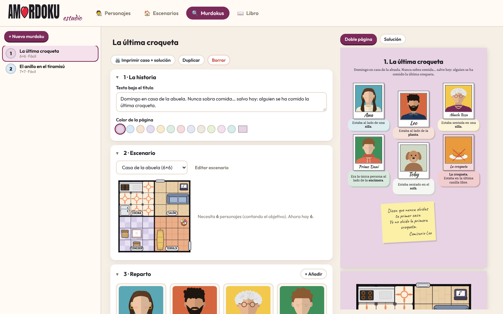
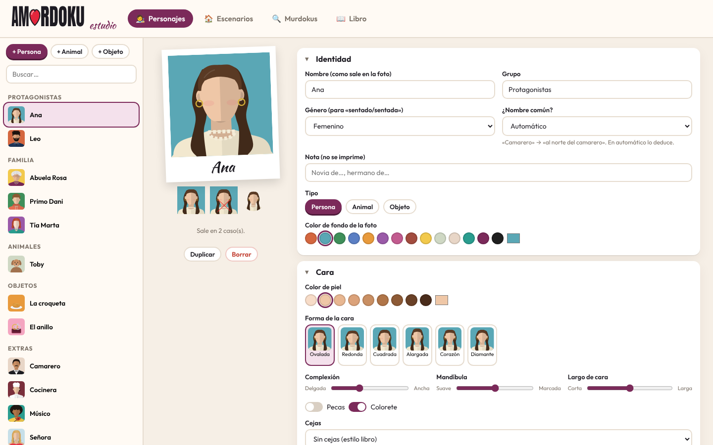
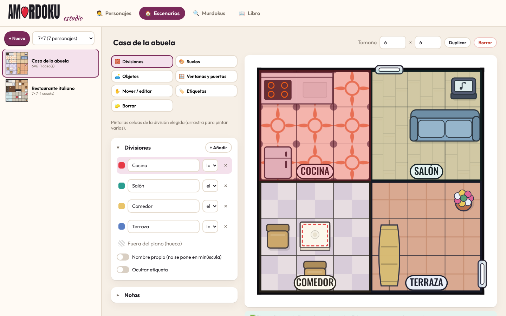
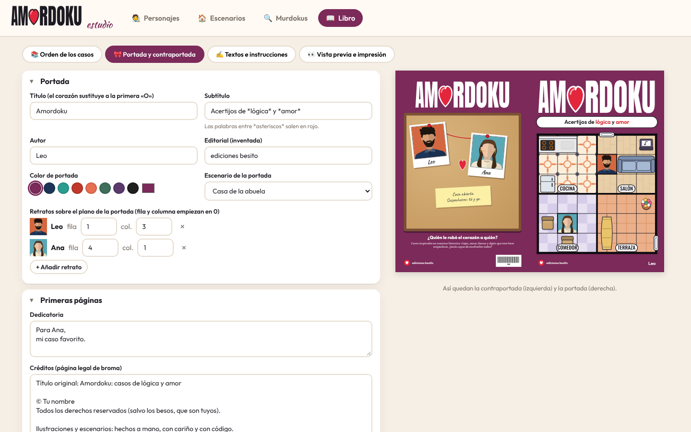

# 💘 Amordoku

**Crea tu propio libro de acertijos de lógica, al estilo de los «murdokus», con tus recuerdos, tus amigos y tus sitios favoritos.** Después, imprímelo y regálalo.

Amordoku es una app web gratuita que funciona en tu ordenador. Con ella puedes:

- 🧑‍🎨 **Diseñar personajes**: pelo, barba, pendientes, gafas, collares, gorros, ropa, pecas… También animales y objetos («la croqueta», «el corazón»).
- 🏠 **Dibujar escenarios**: pintas habitaciones y suelos y colocas más de 80 tipos de objetos (sofás, camas, paellas, kayaks, coches, hogueras…), además de ventanas y puertas.
- 🔍 **Montar cada murdoku**: eliges el reparto, quién es la víctima (o la croqueta robada), quién es el culpable y dónde estaba cada uno en tu recuerdo. **La app escribe las pistas sola** y comprueba que el acertijo tiene una única solución.
- 📖 **Maquetar el libro completo**: portada, contraportada, instrucciones, los casos en el orden que quieras y las soluciones explicadas al final, en el mismo formato que los libros originales (12,7 × 19,05 cm).
- 🖨️ **Descargarlo en PDF** listo para la copistería, o imprimir un solo caso con su solución.

> > El repositorio incluye un **libro de ejemplo** protagonizado por Alex y Victoria.

| Montar un murdoku | Crear personajes |
| --- | --- |
|  |  |
| **Dibujar escenarios** | **Portada y libro** |
|  |  |

---

## Índice

1. [Qué necesitas (todo gratis)](#1-qué-necesitas-todo-gratis)
2. [Instalarlo paso a paso](#2-instalarlo-paso-a-paso)
3. [Abrir la app](#3-abrir-la-app)
4. [Cómo se usa](#4-cómo-se-usa)
5. [Las reglas de un murdoku](#5-las-reglas-de-un-murdoku)
6. [Imprimir el libro (consejos de copistería)](#6-imprimir-el-libro)
7. [Tu libro privado y el ejemplo público](#7-tu-libro-privado-y-el-ejemplo-público)
8. [Subir el proyecto a GitHub](#8-subir-el-proyecto-a-github)
9. [Para programadores: casos escritos en código](#9-para-programadores-casos-escritos-en-código)
10. [Comandos útiles](#10-comandos-útiles)
11. [Problemas frecuentes](#11-problemas-frecuentes)
12. [Créditos y licencia](#12-créditos-y-licencia)

---

## 1. Qué necesitas (todo gratis)

| Programa | Para qué | Dónde |
| --- | --- | --- |
| **Node.js** (versión LTS, 20 o superior) | Ejecuta la app en tu ordenador | <https://nodejs.org> → botón «LTS» |
| **Visual Studio Code** | Abrir la carpeta y la terminal (opcional, pero cómodo) | <https://code.visualstudio.com> |
| **Git** | Solo si quieres subir el proyecto a GitHub | <https://git-scm.com> |
| **Un navegador** | Chrome, Edge o Firefox | Ya lo tienes |

No hace falta saber programar. Solo vas a copiar y pegar tres o cuatro órdenes.

## 2. Instalarlo paso a paso

1. **Instala Node.js**: descarga la versión **LTS** de <https://nodejs.org> e instálala con las opciones por defecto (siguiente, siguiente, siguiente).
2. **Descomprime** la carpeta `amordoku` donde quieras (por ejemplo, en `Documentos`).
3. **Abre la carpeta en Visual Studio Code**: `Archivo → Abrir carpeta…` y eliges `amordoku`.
4. **Abre la terminal** de VS Code: menú `Terminal → Nueva terminal` (abajo aparece una ventanita negra).
5. **Instala las dependencias** (solo la primera vez, tarda uno o dos minutos):

   ```bash
   npm install
   ```

6. (Opcional, para exportar PDF sin el navegador) instala el navegador interno que usa el exportador:

   ```bash
   npx playwright install chromium
   ```

> ¿Sin VS Code? En Windows también vale abrir la carpeta, escribir `cmd` en la barra de direcciones del explorador y pulsar Intro: se abre una terminal ya situada en la carpeta.

## 3. Abrir la app

En la terminal:

```bash
npm run dev
```

Se abrirá el navegador en <http://localhost:5173>. Mientras la terminal esté abierta, la app funciona. Para cerrarla, pulsa `Ctrl + C` en la terminal.

**Tus cambios se guardan solos en el navegador.** Para no perder nada (o para pasar el proyecto a otro ordenador), usa **Inicio → Exportar proyecto** de vez en cuando: descarga un archivo `.json` que puedes volver a cargar con **Importar proyecto**.

## 4. Cómo se usa

### 🧑‍🎨 Personajes

- A la izquierda, la lista por grupos («Amigos de…», «Familia de…»). Con **+ Persona**, **+ Animal** u **+ Objeto** creas uno nuevo.
- A la derecha eliges cada rasgo en rejillas con miniaturas, como en el creador de personajes de un videojuego: forma de cara, complexión, mandíbula, pelo y color, mechas, barba, cejas, gafas, pendientes, collar, gorro, ropa y extras (cámara colgada, guitarra, lágrimas, ramo…).
- **Género**: sirve para que las pistas digan «sentado» o «sentada».
- **¿Nombre común?**: si el personaje se llama «Camarero» o «Abuela Conchi», las pistas dirán «al norte **del camarero**» o «de **la abuela Conchi**». En automático lo deduce solo.

### 🏠 Escenarios

1. **+ Nuevo** y elige el tamaño. **El tamaño marca cuántos personajes caben**: un plano de 7 × 7 es para 7 personajes (contando a la víctima).
2. Herramientas:
   - **Divisiones**: crea habitaciones o zonas («Cocina», «Terraza», «Mar») y píntalas arrastrando. El artículo (el/la/los/las) se usa en las pistas: «estaba en **la** terraza».
   - **Suelos**: madera, baldosas, césped, arena, agua, adoquines… con tus colores. Si le pones una frase («en la arena») podrá salir en las pistas.
   - **Objetos**: elige del catálogo (verás si se **puede ocupar** —sillas, camas, alfombras, coches…— o si **bloquea** la casilla —mesas, plantas, neveras…—) y haz clic donde quieras ponerlo. Puedes cambiar variante, color, giro y tamaño.
   - **Ventanas y puertas**: clic cerca de una pared.
   - **Mover / editar**, **Etiquetas** (dónde aparece el nombre de cada división) y **Borrar**.
3. Abajo verás si el plano es válido (cada fila y columna necesita al menos una casilla libre).

### 🔍 Murdokus

Cada murdoku es una doble página. Rellena las secciones de arriba abajo:

1. **La historia**: título y frase de ambiente.
2. **Escenario**.
3. **Reparto**: añade personajes y marca **🎯 Objetivo** (la víctima, la croqueta, el último rollo de papel…). Con 👕 cambias el vestuario solo para ese caso (traje de fallera, casco de moto, gafas 3D…).
4. **Objetivo y pregunta**: «El asesino es…», «Se la comió…», «Le robó el corazón…», y el remate de la solución («por exceso de besos»).
5. **¿Dónde estaba cada uno en tu recuerdo?** (opcional): marca las divisiones permitidas para cada persona y el generador lo respetará.
6. **Generar pistas**: elige la dificultad (1 a 5) y el culpable (o deja que lo decida la app). Pulsa **✨ Generar pistas**. Si no te gustan, cambia la **semilla** 🎲 y vuelve a generar.
7. **Pistas**: puedes quitar alguna (la app vuelve a comprobar que la solución sigue siendo única) y añadir frases graciosas que no afectan al acertijo.
8. **Pósit, consejo y leyenda**: la nota manuscrita del comisario, los consejos de los primeros casos y los recuadros que explican objetos especiales («Grupo de gente: no se puede ocupar»).

A la derecha tienes la vista previa exacta de la doble página y de la solución. **🖨️ Imprimir caso + solución** imprime solo ese caso.

### 📖 Libro

- **Orden de los casos**: arrastra para reordenar. Lo ideal: de menos a más difícil.
- **Portada y contraportada**: título (el corazón sustituye a la «O»), subtítulo, autor, editorial inventada, color, el escenario que sale en la portada, las fotos del corcho, la dedicatoria y los créditos de broma.
- **Textos e instrucciones**: cambia cualquier frase de las páginas de instrucciones, el glosario o los agradecimientos.
- **Vista previa e impresión**: el libro entero página a página y el botón para sacar el PDF.

## 5. Las reglas de un murdoku

- Cada personaje está en **una fila y una columna diferentes** (como en un sudoku de damas).
- Solo se puede estar en casillas libres o sobre objetos **ocupables** (sillas, camas, alfombras…).
- «**Al lado de**» significa justo encima, debajo, a la izquierda o a la derecha, **y en la misma división**.
- Las **ventanas** están en las paredes: cuentan como «delante» para la casilla que tocan.
- En los casos fáciles, la víctima ocupa **la última casilla libre**. En los difíciles, la víctima estaba **a solas con el culpable** en su división.
- El **culpable** es la única persona que comparte división con la víctima.

En Amordoku la «víctima» puede ser cualquier cosa y el «asesino» cualquier papel: quien se comió la croqueta, quien consoló a alguien, quien escondió el as de oros…

**Cómo sabe la app que el acertijo es justo**: tiene dos solucionadores. Uno «humano» que razona como tú (casilla única, filas y columnas, divisiones, conteos…) y mide la dificultad; y otro exhaustivo que prueba todas las combinaciones para garantizar que **solo hay una solución**.

## 6. Imprimir el libro

### Sacar el PDF

**Opción A (desde la app)**: `Libro → Vista previa e impresión → Abrir para imprimir`. En el diálogo del navegador:

- Destino: **Guardar como PDF**
- Márgenes: **Ninguno**
- Escala: **100 %** (o «Tamaño real»)
- **Gráficos de fondo**: activado

**Opción B (calidad de imprenta, recomendada)**: en la terminal

```bash
npm run pdf
```

Crea `out/amordoku.pdf` con el tamaño exacto. Si has hecho cambios en la app, primero **expórtalos** (Inicio → Exportar proyecto) y luego:

```bash
npm run pdf -- --proyecto ruta/al/archivo-exportado.json
```

Un solo caso: `npm run pdf -- --caso id-del-caso`.

### En la copistería

- **Tamaño de página**: 12,7 × 19,05 cm (el del libro original). Si la copistería solo trabaja con A5 (14,8 × 21 cm), pide **«imprimir a tamaño real, sin escalar, centrado»** y que **recorten** a 12,7 × 19,05 cm; o activa el sangrado en `Libro → Portada → Impresión` si te lo piden.
- **Interior**: papel offset de **100–120 g**, a doble cara y **a color**. El número de páginas ya es múltiplo de 4 (la app añade páginas en blanco si hace falta).
- **Cubierta**: cartulina de **300–350 g** con **plastificado mate** (queda como los originales). Portada y contraportada están en la primera y la última página del PDF.
- **Encuadernación**: **rústica fresada** (con lomo, la más parecida a un libro de verdad). La espiral es más barata y cómoda para escribir, pero se nota que es casero. El grapado solo funciona con pocos casos.
- Pide **una prueba** de una o dos hojas antes de imprimir todo para comprobar colores y tamaño.
- Llévate un **lápiz con goma** de regalo: los murdokus se tachan 😉.

Alternativa: servicios de impresión bajo demanda por internet permiten imprimir un único ejemplar con lomo a partir de un PDF.

## 7. Tu libro privado y el ejemplo público

```
amordoku/
├── examples/            ← ejemplo PÚBLICO (Alex y Victoria). Se sube a GitHub.
└── private/             ← TU libro (fotos, nombres, recuerdos). Está en .gitignore:
    ├── characters.ts       NO se sube nunca.
    ├── book.ts
    ├── cases/
    └── amordoku.project.json
```

- Si existe `private/amordoku.project.json`, la app arranca con tu libro; si no, con el ejemplo.
- Si lo regeneras con `npm run libro`, la app te avisará arriba de que hay una versión nueva para cargarla.
- Si alguien clona tu repositorio, verá la app funcionando con el ejemplo… y nada de tu vida privada.

## 8. Subir el proyecto a GitHub

1. Crea una cuenta en <https://github.com> e instala **Git** (o **GitHub Desktop**, más visual).
2. En GitHub: **New repository** → nombre `amordoku` → público → **sin** README (ya tienes uno) → Create.
3. En la terminal, dentro de la carpeta del proyecto:

   ```bash
   git init
   git add .
   git status          # comprueba que NO aparece la carpeta private/
   git commit -m "Amordoku: generador de libros de acertijos de lógica personalizados"
   git branch -M main
   git remote add origin https://github.com/TU-USUARIO/amordoku.git
   git push -u origin main
   ```

4. En `git status` **no debe salir nada de `private/`**. Si sale, revisa que el archivo `.gitignore` está en la carpeta.

**Idea para tu portfolio**: en la descripción del repositorio cuenta que incluye un motor de satisfacción de restricciones con dos solucionadores (deductivo y exhaustivo), un generador de casos guiado por contraejemplos con control de dificultad y una app React con web workers. Tienes los detalles técnicos en [ARCHITECTURE.md](ARCHITECTURE.md).

## 9. Para programadores: casos escritos en código

Además de la app, los casos se pueden escribir en TypeScript con un mini-lenguaje muy compacto (así está hecho el libro privado y el ejemplo):

```ts
const casa = scenario({
  id: 'casa-abuela',
  name: 'Casa de la abuela',
  map: ['KKKSSS', 'KKKSSS', 'KKKSSS', 'CCCTTT', 'CCCTTT', 'CCCTTT'], // una letra por división
  rooms: { K: { name: 'Cocina', floor: 'k' }, S: { name: 'Salón', floor: 's' } /* … */ },
  floors: { k: ['hydraulic', '#fbefdc', '#e98a5b'], s: ['wood'] /* … */ },
  objects: [['sofa', 1, 4, 2, 1], ['table', 4, 1, 1, 1, { variant: 'mantel' }]], // tipo, fila, columna, ancho, alto
  edges: [['window', 0, 3, 'top']],
});

export const CASO: CaseDef = {
  id: 'ej1-croqueta', title: 'La última croqueta', scenario: casa,
  people: ['ana', 'leo', 'abuela', 'primo', 'perro', 'croqueta'],
  target: 'croqueta', culprit: 'perro', question: 'Se la comió...', tier: 1,
  pins: [{ p: 'abuela', rooms: ['Cocina', 'Comedor'] }],               // restricciones de la historia
  /* … */
};
```

Mira `examples/example.ts` y genera el JSON con `npm run example`.

## 10. Comandos útiles

| Comando | Qué hace |
| --- | --- |
| `npm run dev` | Abre la app |
| `npm run pdf` | Exporta el libro a `out/amordoku.pdf` |
| `npm test` | Pasa las pruebas automáticas (motor, solucionadores, ejemplo) |
| `npm run typecheck` | Revisa los tipos de TypeScript |
| `npm run build` | Compila la app en `dist/` (por si quieres publicarla, p. ej. en GitHub Pages) |
| `npm run example` | Regenera el proyecto de ejemplo |
| `npm run libro` | Regenera tu libro privado desde `private/cases` |

## 11. Problemas frecuentes

- **`npm` no se reconoce**: cierra y vuelve a abrir VS Code (o el ordenador) después de instalar Node.js.
- **La app no refleja un libro regenerado**: pulsa «Cargarla» en el aviso amarillo de arriba, o `Inicio → Restaurar el original`.
- **El PDF del navegador sale con márgenes blancos o más pequeño**: márgenes «Ninguno» y escala 100 %. Mejor aún: `npm run pdf`.
- **«El caso tiene varias soluciones»**: añade restricciones de historia, cambia la semilla o sube la dificultad. Si dos personas están siempre juntas en sitios idénticos (dos sillas iguales), dale a alguna un detalle que la distinga (una ventana, un objeto distinto).
- **«El plano necesita N personajes»**: el número de personajes (contando el objetivo) debe ser igual al tamaño del plano.
- **`npm run pdf` dice que falta el navegador**: `npx playwright install chromium`.

## 12. Créditos y licencia

- © 2026 Alejandro Bueno. **Todos los derechos reservados** (ver `LICENSE`). Puedes ver el código y probar la demo, pero no copiarlo ni reutilizarlo sin permiso.
- Amordoku es un homenaje al **formato** de los libros de acertijos «murdoku»; no está afiliado a ellos. Todas las ilustraciones, escenarios, textos y acertijos se generan con este proyecto: no incluye material de los libros originales.
- Tipografías libres de Google Fonts (vía Fontsource): Outfit, Kaushan Script, Oswald, Roboto Slab, Crimson Pro, Caveat y Anton.

Hecho con ❤️ para regalar.
